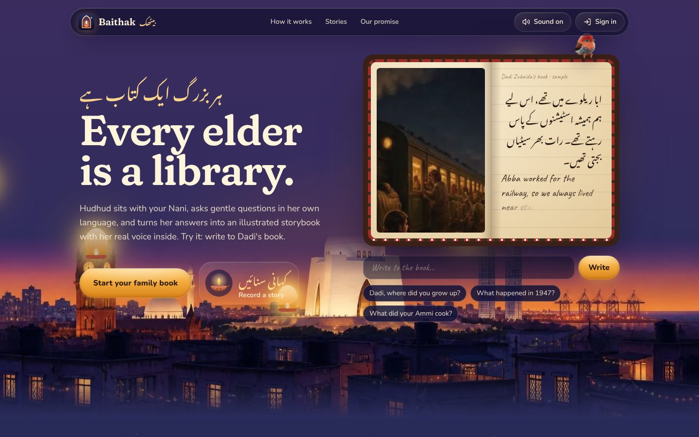
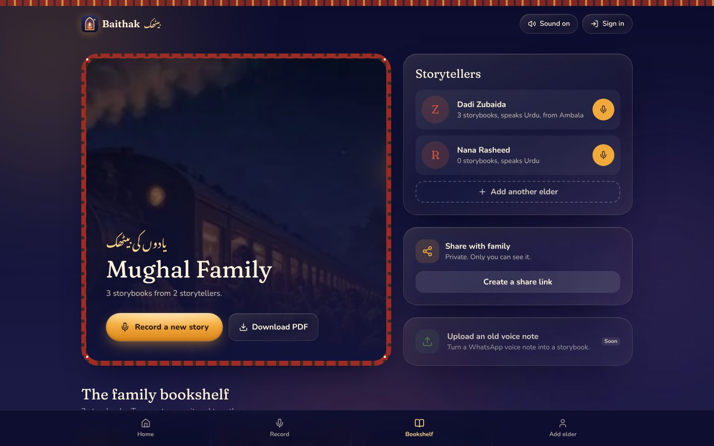
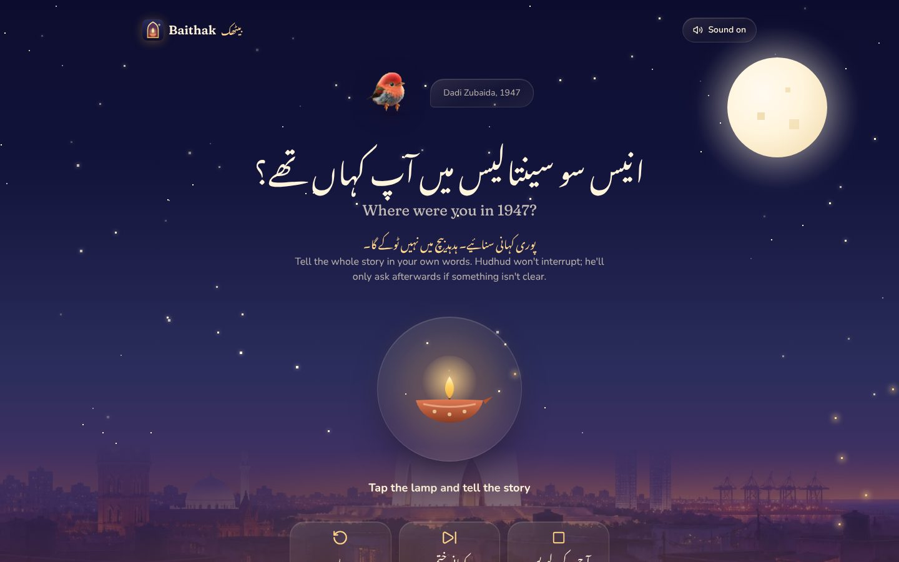
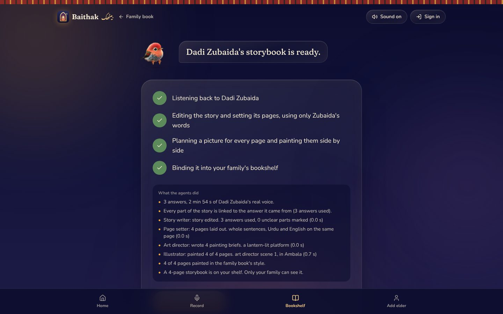
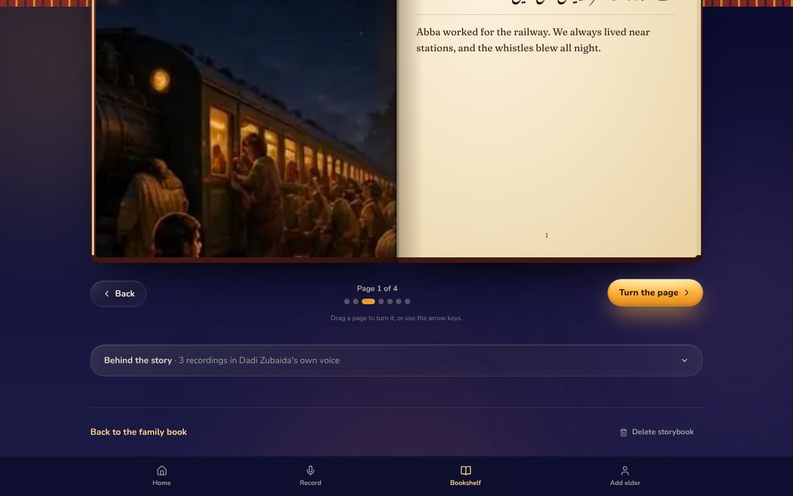

# Yaadon ki Baithak (یادوں کی بیٹھک)

**An AI agent that sits with your grandparents, listens to their stories in Urdu, and turns
them into an illustrated family storybook, with their real voice inside.**

Built for the **NYLP AI Hackathon 2026**: *Build AI for Real-World Impact*.

| | |
| --- | --- |
| **Live app** | https://yaadon-ki-baithak.vercel.app |
| **Backend API** | https://yaadon-ki-baithak.onrender.com ([health check](https://yaadon-ki-baithak.onrender.com/health); the free plan sleeps when idle and takes up to a minute to wake) |
| **Demo video** | _add the video link here_ |
| **Repository** | https://github.com/CodeVoyager007/Yaadon-Ki-Baithak |



---

## Problem

Every family has a Nani or a Dada with stories nobody wrote down: 1947, the old city, the
wedding, the recipes. They are told in Urdu, out loud, and when the storyteller is gone, the
stories go with them. Grandchildren who read English better than Urdu often can't follow
them, and nobody has the time to sit, record and transcribe.

**Who it's for:** families in Pakistan and the diaspora who want to keep their elders'
memories, and elders who are more comfortable speaking than typing, and speaking Urdu.

## Solution

Yaadon ki Baithak (*a gathering of memories*) turns a conversation into a book.

1. **Hudhud listens.** Hudhud, a hoopoe from Urdu folk tales, asks the elder for consent,
   then lets them tell the whole story in one go, without interrupting.
2. **Hudhud asks only what's missing.** It reads the story and asks at most three gentle
   questions about what a grandchild couldn't follow (who "he" was, where, when), in Urdu,
   spoken aloud. It notices grief or tiredness and slows down or stops.
3. **A line of AI agents makes the book.** The story writer edits it in the elder's own voice,
   the page setter lays out the pages, the art director plans a picture for each page, and
   the illustrator paints them in one consistent storybook style.
4. **The family reads it.** It opens as a hardcover book with pages you turn by hand, in Urdu,
   English or both, with a button that plays the elder telling the whole story in their real
   voice.

**Nothing is invented.** The writer may only use what the elder said. Code checks that every
quote was really said and every year was really mentioned, and every page is linked to the
recording it came from.

## Features

- **Voice-first, in Urdu.** The elder only talks; Hudhud's questions are spoken aloud in Urdu
  with English underneath.
- **Story first, questions after.** At most three clarifying questions, only about real gaps.
- **Consent on the record** before anything is saved.
- **Illustrated storybook** of 4 to 8 pages, every page painted, in Urdu and English.
- **A real book to read:** a hardcover that opens and pages you turn by dragging or with the
  arrow keys.
- **Their real voice:** one player plays the whole story as it was told. No voice cloning.
- **PDF download** of one book or the whole family collection, with proper Urdu script.
- **Private share links** for relatives (read-only, unguessable), e.g. on WhatsApp.
- **Many storytellers, many books** on one family bookshelf, restored on any device after
  sign-in.
- **Works when AI is busy:** if a model is out of quota, the book is still made from the
  elder's own words, laid out and painted, and can be rewritten later.

## Screenshots

| | |
| --- | --- |
|  |  |
| **The family bookshelf**: storytellers, books, sharing and PDF | **Recording**: the elder taps the lamp and tells the story |
|  |  |
| **The agents at work**: each agent reports what it did | **The storybook**: a hardcover with the painting and title |



## AI methodology

AI isn't decoration here: four agents make decisions, and code checks each one.

```
                  ┌──────────── live conversation ─────────────┐
  elder's voice ─▶│ Hudhud (interviewer): reads the story,     │─▶ a clarifying question, or "ready"
                  │ asks ≤ 3 questions, notices grief/fatigue  │
                  └──────────────────────┬─────────────────────┘
                                         │ hand-off
  ┌──────────────────────────── the book line ────────────────────────────────┐
  │ story writer ─▶ page setter ─▶ art director ─▶ illustrator (in parallel)   │─▶ storybook
  │   (edits)       (layout,        (a brief per     (paints every page)       │
  │                  plain code)     page)                                     │
  └────────────────────────────────────────────────────────────────────────────┘
```

| Agent | What it decides | How it's kept honest |
| --- | --- | --- |
| **Hudhud (interviewer)** | Each turn: ask a clarifying question, or hand off to the writer | In code: at most 3 questions, never before the story is told, one question at a time; questions asking for phone, ID, bank or address details are rejected and retried; grief, 1947 violence and tiredness cues (English, Roman Urdu, Urdu script) make it gentler |
| **Story writer** | The edited story in the elder's voice, Urdu plus a faithful English translation | Only the elder's words: a quote not found word for word in a recording is dropped, a year never said is dropped, unclear parts are marked `[unclear]`, never guessed |
| **Page setter** (plain code) | 4 to 8 pages at whole sentences, both languages split at the same points | Deterministic, free, can't run out of quota |
| **Art director** | One calm painting brief per page, plus the cover | No faces of real people, nothing graphic (even for 1947); the painter only ever sees these briefs, never the elder's words |
| **Illustrator** | Paints every page in one fixed gouache style | Graphic scenes are swapped for quiet symbols (a train, a lantern); a failed painting keeps a themed picture |
| **Orchestrator** (plain code) | Hand-offs and fallbacks | Every step has a fallback; a trace of each step is shown to the family |

**Prompting.** Each agent has its own system prompt with hard rules; transcripts are fenced
between `<<<` and `>>>` as data so an answer can't act as an instruction. Models reply in JSON,
and every reply is validated and checked in code before it's used, with one retry.

**Resilience.** Keys and models rotate: when a model is out of quota, the backend tries the
next free model, and waits out per-minute limits for the book. If the writer still can't run,
the book is made from the elder's own words (labelled as a draft) and a "Write it properly"
button sends it back through the agents later.

### Models and APIs

| Third-party API | Model | Used for |
| --- | --- | --- |
| Google Gemini API | `gemini-2.5-flash` | Hudhud's decisions, the story writer |
| Google Gemini API | `gemini-2.5-flash-lite` | Art director's briefs, Urdu speech-to-text, and the fallback model |
| Google Gemini API | `gemini-2.5-flash-preview-tts` | Hudhud's spoken questions |
| Cloudflare Workers AI | `@cf/black-forest-labs/flux-1-schnell` | Page paintings |
| Cloudflare Workers AI | `@cf/openai/whisper-large-v3-turbo` | Speech-to-text fallback |
| Supabase | (not AI) | Sign-in, Postgres database, private storage for voices and paintings |

All models are configurable through environment variables. Every AI key stays on the backend;
the browser never sees one.

## Tech stack

- **Frontend:** Next.js 16, React 19, TypeScript, Tailwind CSS 4, Motion. Hosted on Vercel.
- **Backend:** Python 3.11+, FastAPI, httpx, Pydantic. Docker on Render.
- **AI:** Google Gemini API, Cloudflare Workers AI.
- **Data:** Supabase (Auth, Postgres with row level security on every table, private storage).
- **Tooling:** uv (Python), npm workspaces, pytest.

## Setup

You need **Python 3.11+ with [uv](https://docs.astral.sh/uv/)** and **Node 20.9+**.

```bash
git clone https://github.com/CodeVoyager007/Yaadon-Ki-Baithak.git
cd Yaadon-Ki-Baithak
```

**1. Backend (the agents)**

```bash
cd backend
uv init                                  # first time only; the generated files are git-ignored
uv venv
uv add -r requirements.txt
uv add --dev pytest
cp .env.example .env                     # add your keys (see below); keep APP_ENV=development
uv run uvicorn app.main:app --env-file .env --reload --port 8000
```

**2. Frontend**, from the repo root in a second terminal:

```bash
npm install
cp frontend/.env.example frontend/.env.local   # NEXT_PUBLIC_API_URL=http://localhost:8000
npm run dev
```

Open http://localhost:3000.

**3. Keys** (all have free tiers; never commit them, both `.env` files are git-ignored):

| Key | Where to get it | Goes in |
| --- | --- | --- |
| `GEMINI_API_KEY` (more in `GEMINI_API_KEYS`) | [Google AI Studio](https://aistudio.google.com) | `backend/.env` |
| `CLOUDFLARE_ACCOUNT_ID`, `CLOUDFLARE_API_TOKEN` (Workers AI) | Cloudflare dashboard | `backend/.env` |
| Supabase URL and keys | Supabase project, [step-by-step guide](docs/SUPABASE_SETUP.md) | both `.env` files |

Check every key end to end, including how much Gemini quota is left today:

```bash
cd backend && uv run python -m app.check
```

With no keys at all, the app still runs in demo mode on clearly labelled stand-ins.

**4. Tests**

```bash
cd backend && uv run pytest     # 68 tests: agents, page setter, orchestrator, HTTP and security; no keys needed
npm run build                   # frontend production build, from the repo root
```

**5. Deploy:** backend to Render ([backend/README.md §6](backend/README.md#6-deploy)),
frontend to Vercel with Root Directory `frontend` and the four `NEXT_PUBLIC_` variables, then
add the Vercel URL to the backend's `ALLOWED_ORIGINS` and to Supabase's Auth URL settings.

## Privacy, ethics and safety

- The elder agrees on the record before anything is saved; the consent clip is kept.
- Each family's data is private to its account (row level security on every table; private
  storage served through short-lived signed links). Share links are read-only and unguessable.
- No voice cloning: only the elder's real recordings are ever played.
- The writer never invents facts; the painter never sees the elder's words or photo.
- Hudhud never asks for phone numbers, ID cards, bank details or addresses.
- Requests are size-capped and rate-limited; logins are verified on every AI call.

## Known limitations

- Free AI tiers have daily limits. When they run out, books are drafts (the elder's own words,
  still laid out and painted) until quota returns; the "Write it properly" button finishes them.
- Speech-to-text works best with clear audio; heavy background noise lowers accuracy.
- Urdu and English only for now. Hudhud's Urdu voice is a preview model and can sound
  synthetic; the browser's voice is used when it's unavailable.
- Paintings are illustrative, not historical records.

## Future improvements

- Turn old WhatsApp voice notes into storybooks.
- Punjabi, Sindhi, Pashto and Saraiki.
- A printed hardcover ordered straight from the app.
- A family tree that links stories, people and places.

## Team contributions

| Member | Role | What they built |
| --- | --- | --- |
| **Ayesha Mughal** | Team lead, frontend, UI/UX, AI agents | The whole interface and design system (home, recording room, storybook reader with page turns, bookshelf, PDF, sharing) and the AI agents: Hudhud, the story writer, the page setter, the art director, the illustrator and the orchestrator |
| **Faria** | Backend developer | The FastAPI backend: routes, authentication, rate limits, provider clients and storage |
| **Humema Israr** | Documentation and presenter | Documentation, the demo video and the presentation |

**Development tools:** AI coding assistants were used during development. All code was
reviewed and tested by the team (68 automated backend tests, plus manual testing of every flow).

## Acknowledgements

Next.js, React, Tailwind CSS, Motion, FastAPI, Pydantic, httpx, Supabase, lucide-react,
html-to-image and jsPDF (PDF export), Google Gemini and Cloudflare Workers AI. Fonts
(Fraunces, Nunito, Noto Nastaliq Urdu, Caveat) self-hosted through Fontsource.

## More documentation

| Doc | What it covers |
| --- | --- |
| [backend/README.md](backend/README.md) | The agents in detail, routes, error contract, security, deploy |
| [docs/SUPABASE_SETUP.md](docs/SUPABASE_SETUP.md) | Supabase from zero: project, SQL, keys, sign-in |
| [docs/SETUP.md](docs/SETUP.md) | Environment variables, security checklist, team rules |
| [frontend/DESIGN.md](frontend/DESIGN.md) | The design system |
